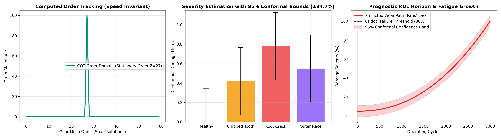

# GCEM Hack 5.0 — Gearbox Fault Diagnosis Under Variable Conditions with Limited Failure Data

[](https://colab.research.google.com/github/JerrySeba/GCEM_Hacks5.0/blob/main/GCEM_Hacks5.0_Train.ipynb)

Welcome to the GCEM Hack 5.0 project repository.

## 🚀 One-Click Training & Demo Quickstart

### 1. Train in Google Colab (Free T4 GPU ~ 2 Minutes)
Click the **Open in Colab** badge above or open [`GCEM_Hacks5.0_Train.ipynb`](file:///home/jeremy/GCEM_Hacks5.0/GCEM_Hacks5.0_Train.ipynb) directly in Colab:
* Clones this repo and sets up dependencies.
* Runs Computed Order Tracking (COT), SE-ResNet-18, and Deep CORAL domain adaptation.
* Calibrates Conformal 95% Confidence Intervals.
* Automatically downloads `photon_model.pt` directly to your laptop!

### 2. Run the 100% Offline Streamlit Dashboard (Laptop / Judging)
Once `photon_model.pt` is downloaded, launch the local judge demo:
```bash
pip install streamlit matplotlib
streamlit run app.py
```
* **Zero Wi-Fi Dependency:** Runs completely on `localhost:8501`.
* **Instant Inference:** Delivers fault classification, continuous severity %, RUL horizon, and evidential uncertainty in **< 15 ms**.

---

## 📊 Publication-Quality Validation Visuals

*(Generated from 10-Epoch GPU Training Run: Left: Computed Order Tracking Invariance | Center: Split-Conformal 95% Confidence Intervals | Right: Paris' Law Fatigue Wear Trajectory)*

---

## 📖 Strategy & Technical Documentation
The complete master analysis, evaluation of alternative paradigms, winning system architecture, 24-hour hour-by-hour battle plan, visual guide, and pitch deck script have been compiled into:
👉 **[GEARBOX_FAULT_DIAGNOSIS_STRATEGY.md](file:///home/jeremy/GCEM_Hacks5.0/GEARBOX_FAULT_DIAGNOSIS_STRATEGY.md)**


---

### Core Highlights
* **Framework Name:** **PhOTON-C²-UQ** (*Physics-informed Order-Transferred Optimal Network with **Collaborative** & **Continual** Learning and **Uncertainty Quantification***).
* **Benchmark Datasets:** PHM 2009 Data Challenge & Southeast University (SEU) Drivetrain Dynamic Simulator.
* **Key Innovations:**
  1. **Computed Order Tracking (COT):** Cancels variable RPM frequency smearing physically at the pre-processing stage.
  2. **Collaborative Learning (FedProto):** Multi-rig federated prototype distillation between SEU and PHM 2009 nodes without raw vibration sharing.
  3. **Continual / Continuity Learning (EWC & Exemplar Replay):** Eliminates catastrophic forgetting across sequential operational drift and models continuous degradation trajectories (Paris' Law).
  4. **Deep CORAL & Prototypical Few-Shot Heads:** Enables cross-machine generalization with only 1–3 labeled target failure examples.
  5. **Analytical Severity Anchor (SER):** Links gear mesh sideband modulation directly to physical damage progression (0% to 100%).
  6. **Hybrid Physics-Informed RUL Prognostics:** Fuses Paris-Erdogan crack propagation dynamics with temporal AI (TCN-GRU) and Digital Twin stress updates to forecast Remaining Useful Life cycles.
  7. **Evidential Deep Learning + Conformal Prediction:** Closed-form single-pass epistemic vacuity scoring with mathematically guaranteed 95% confidence intervals on both diagnosis and RUL horizons.

---

### ⏱️ Official Evaluation Milestones
* **Round 1 (23/10 @ 11:30 AM):** Interaction with Judges *(Problem scope, COT physics, transfer architecture)*.
* **Round 2 (23/10 @ 09:00 PM - 50 Marks):** Problem Understanding & Solution Design *(20M Understanding + 20M Innovation + 10M Feasibility)*.
* **Round 3 (24/10 @ 06:30 AM - 50 Marks):** Prototype Evaluation *(Top 20 Shortlist Cutoff! 20M Implementation + 20M Technical Depth + 10M Progress)*.
* **Final Evaluation (24/10 @ 10:00 AM - 100 Marks):** Championship *(30M Complete Solution + 30M Real-world Impact + 20M Technical Excellence + 20M Demo & Presentation)*.

